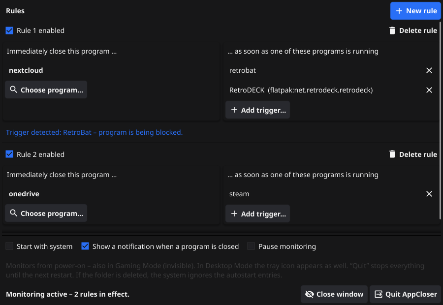

<p align="center"></p>

<h1 align="center">AppCloser</h1>

<p align="center">Instantly closes a program as soon as another program starts — and keeps it closed while that program runs.</p>

---

Typical use: a cloud sync client (Nextcloud, OneDrive, …) must not sync while an
emulator frontend or game is writing to the synced folder. Add a rule
*“close Nextcloud while RetroBat runs”* and AppCloser takes care of it.

<p align="center"></p>

## Features

- **Rules:** left the program to close, right any number of triggers. As many rules as you like.
- **Instant and hard:** the program is terminated immediately (no graceful shutdown) and blocked from restarting while a trigger runs.
- **Launchers are understood:** programs started by a trigger count as triggers too
  (e.g. a launcher that starts the real program and exits). Windows system helpers
  and leftovers of a closed program are ignored.
- **Linux / Steam Deck:** Flatpak apps (e.g. RetroDECK) are detected including all
  their subprocesses, also when a game is started from the Steam library.
  With *Start with system*, monitoring also runs in **Gaming Mode**.
- **Tray icon** with notifications, pause and quit.
- **Portable:** no installation. Settings and caches live in the program folder —
  deleting the folder removes everything.
- **Lightweight:** the always-running part uses no GUI toolkit
  (≈ 0.5 % of one CPU core and ≈ 11 MB RAM, measured on Linux with ~330 processes).
  The settings window is a separate process that only runs while it is open.

## Download

Get the latest ZIP for Windows or Linux from the
[Releases](../../releases) page, extract it and start `AppCloser` (`AppCloser.exe` on Windows).
Keep both files (`AppCloser` and `AppCloser-Settings`) together.

- **Windows:** SmartScreen may warn on first start (the program is not signed):
  *More info → Run anyway*.
- **Steam Deck / Linux:** right-click both files → *Properties → Permissions → Is executable*.

## Building

Requires Go 1.26+. The settings window uses [Fyne](https://fyne.io) (cgo).

```bash
./build.sh
```

builds all four programs into `dist/` (Linux needs the usual Fyne build
dependencies; Windows binaries are cross-compiled with `mingw-w64`).

| Program | Build |
|---|---|
| `AppCloser` – tray, monitoring, `--headless` background service | `CGO_ENABLED=0 go build .` |
| `AppCloser-Settings` – settings window | `go build -tags gui .` |

## License

[MIT](LICENSE)
