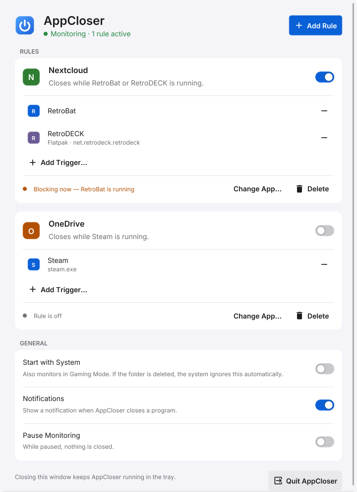

<p align="center"></p>

<h1 align="center">AppCloser</h1>

<p align="center">Instantly closes a program as soon as another program starts — and keeps it closed while that program runs.<br>
For Windows, macOS and Linux (incl. Steam Deck).</p>

---

Typical use: a cloud sync client (Nextcloud, OneDrive, …) must not sync while an
emulator frontend or game is writing to the synced folder. Add a rule
*“close Nextcloud while RetroBat runs”* and AppCloser takes care of it.

<p align="center"></p>

## Features

- **Rules:** choose the program to close and any number of triggers. As many rules as you like.
- **Instant and hard:** the program is terminated immediately (no graceful shutdown) and blocked from restarting while a trigger runs.
- **Launchers are understood:** programs started by a trigger count as triggers too
  (e.g. a launcher that starts the real program and exits). System helpers
  and leftovers of a closed program are ignored.
- **Linux / Steam Deck:** Flatpak apps (e.g. RetroDECK) are detected including all
  their subprocesses, also when a game is started from the Steam library.
  With *Start with System*, monitoring also runs in **Gaming Mode**.
- **macOS:** a menu bar app (no Dock icon) with a template icon that follows light and dark mode.
- **Tray / menu bar icon** with notifications, pause and quit.
- **Portable:** no installation. Settings and caches live in the program folder —
  deleting the folder removes everything.
- **Lightweight:** the always-running part uses no GUI toolkit
  (≈ 0.5 % of one CPU core and ≈ 11 MB RAM, measured on Linux with ~330 processes).
  The settings window is a separate process that only runs while it is open.
- **Sleep-friendly:** AppCloser never keeps a computer awake and never wakes it up.

## Download

Get the latest ZIP for your system from the [Releases](../../releases) page.

### Windows

Extract the ZIP and start `AppCloser.exe`. Keep both files (`AppCloser.exe` and
`AppCloser-Settings.exe`) together. SmartScreen may warn on first start (the program
is not signed): *More info → Run anyway*.

### macOS (11 or later, Apple silicon and Intel)

1. Create a folder (e.g. `/Applications/AppCloser`) and move `AppCloser.app` into it.
   Settings are stored next to the app, so deleting this folder removes everything.
2. Open the app. macOS blocks it the first time because it is not notarized:
   *System Settings → Privacy & Security → Open Anyway*.

AppCloser then appears in the menu bar. macOS asks once whether it may show notifications.

### Linux / Steam Deck

Extract the ZIP, right-click both files → *Properties → Permissions → Is executable*,
then start `AppCloser`. Keep both files together.

## Troubleshooting

Start AppCloser from a terminal with `--debug` to see which processes match a rule
and the result of every attempt to close a program:

```bash
# macOS
/Applications/AppCloser/AppCloser.app/Contents/MacOS/AppCloser --debug
# Linux
./AppCloser --debug
```

Quit a running AppCloser first; otherwise the new one only brings up the settings window.

## Building

Requires Go 1.26+. The settings window uses [Fyne](https://fyne.io) (cgo).

```bash
./build.sh       # Windows + Linux, on Linux (Windows cross-compiled with mingw-w64)
./build-mac.sh   # AppCloser.app (universal, ad-hoc signed), on macOS with Xcode tools
```

| Program | Build |
|---|---|
| `AppCloser` – tray / menu bar, monitoring, `--headless` background service (Linux) | `go build .` (no cgo needed on Windows and Linux) |
| `AppCloser-Settings` – settings window | `go build -tags gui .` |

## Releases

Releases are published automatically: when `VERSION` on `main` contains a
version that has no release yet, the build creates release `v<VERSION>` with
the ZIPs for Windows, macOS and Linux attached.

## License

[MIT](LICENSE). The settings window uses the [Inter](https://rsms.me/inter/) typeface
by Rasmus Andersson, licensed under the SIL Open Font License ([fonts/Inter-LICENSE.txt](fonts/Inter-LICENSE.txt)).
